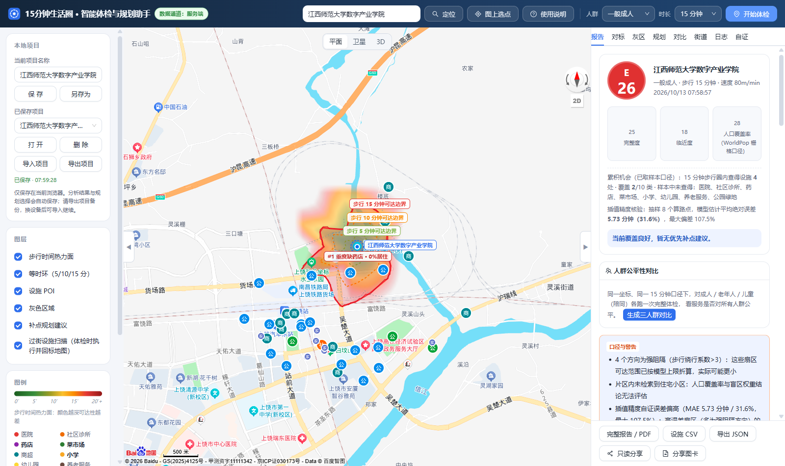
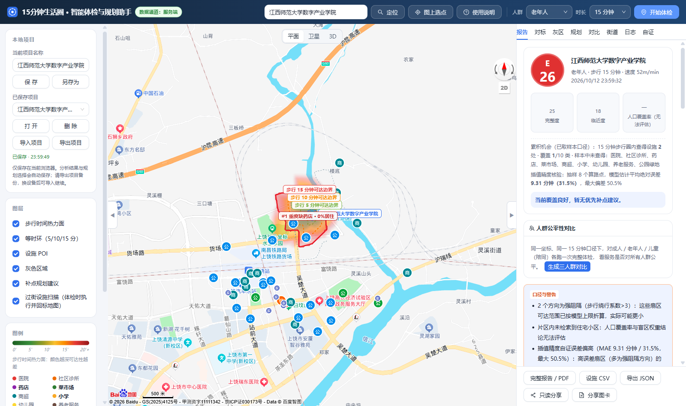
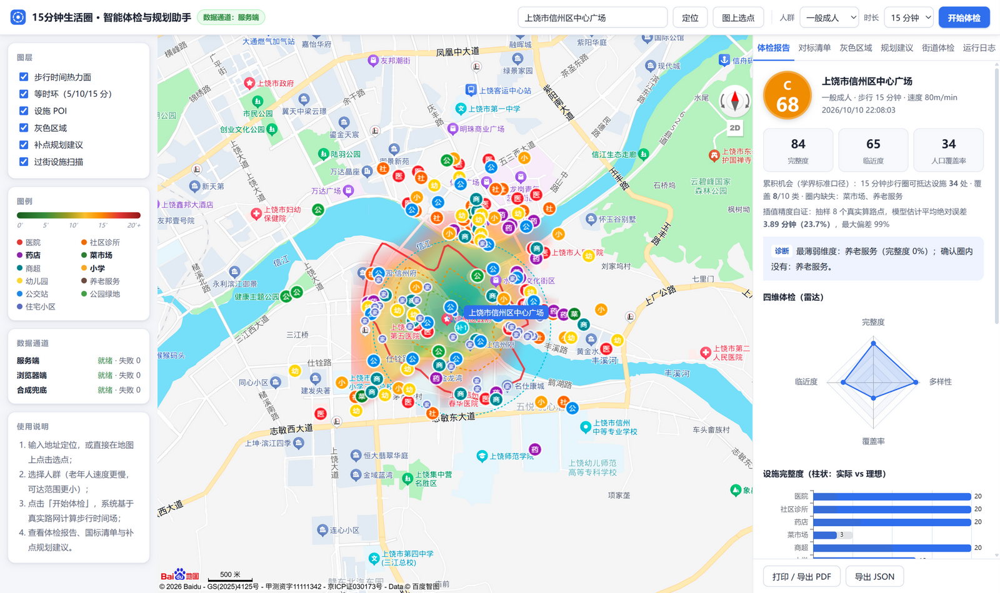
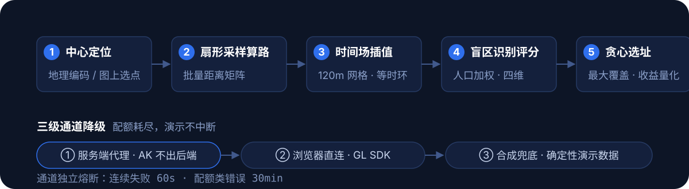

<p align="center">
  
</p>

<p align="center">
  <a href="https://github.com/nghqqa/life-circle-15min/actions/workflows/ci.yml"></a>
  
  
  
</p>

## 实测效果

同一座城市，两个社区，系统的区分度（以下均为当前版本在真实数据下的实测结果）：

**样例 A · 新校区（成人）—— E 级 21 分 · 人口覆盖率 0%**

药店、幼儿园、养老服务、公交站、公园绿地全部为 0 家——新建校区配套空白的极端案例，
重度灰色区域覆盖全部居住权重：



**样例 A · 老年人视角 —— 可达圈明显收缩**

步行速度 80 → 52 m/min，5/10 分钟环显著收缩，重度缺失（三类全无）居住权重占比 100%：
成人尚可勉力走到最近的商超与诊所，老年人 15 分钟内无任何核心设施：



**样例 B · 老城核心（对照）—— C 级 68 分**

医院 20 · 社区诊所 20 · 药店 20 · 幼儿园 20 · 公交站 20（检索返回上限），
设施齐备程度与样例 A 形成鲜明对比，验证系统区分度：



完整数据、人工核对过程与误差来源见 [真实对比测试报告](docs/COMPARISON_TEST.md)。

## 这是什么

「15 分钟便民生活圈」是国家推行的社区配套建设标准：居民步行 15 分钟内应能获得基础医疗、教育、购物、养老服务。传统评估依赖人工普查和静态直线距离，看不见**真实路网的绕行**，也说不清**缺了该在哪补**。

本项目基于百度地图开放能力（地理编码 / POI 检索 / 批量算路 / 步行路径规划）把这件事自动化：**输入一个中心点 → 计算真实路网的步行等时圈 → 统计圈内民生设施覆盖 → 标注人口加权的灰色区域 → 求解补点选址建议**。适用于社区体检、片区配套评估与规划讨论。

## 为什么不同

- **连续步行时间场，而不是一圈多边形** —— 48 向扇形采样 + 批量距离矩阵求各方向绕行系数，插值成 120m 网格的"走到中心要几分钟"连续场，渲染为平滑热力面与 5/10/15 分钟三层等时环；
- **体检之后给"处方"** —— 对每个灰色斑块用贪心最大覆盖模型求解补点位置与设施类别，输出量化收益（如"补建菜市场，该类居住覆盖率 68% → 100%"），这是多数同类工具没做的"规划助手"半边题眼；
- **体检结论分人群** —— 一般成人 / 老年人 / 儿童三档步行速度（80/52/65 m/min），同一社区在不同人群视角下可达范围与结论不同；
- **三级通道降级，演示永不中断** —— 服务端代理（AK 不出后端，带缓存与限流）→ 浏览器直连（GL SDK）→ 确定性合成数据；通道独立熔断，配额耗尽自动兜底；
- **分析能力开放为 API** —— `POST /api/analyze` 单点完整体检、`POST /api/batch/street` 街道级批量体检（片区内住宅小区逐个评分并排名），附 OpenAPI 描述与文档页（`/api/docs`）。

## 工作原理

<p align="center">
  
</p>

等时圈模型：探针落在 `probeM = t·v` 直线半径上，批量算路返回真实路网距离，得到各方向绕行系数 `f(θ) = 路网距离 / 直线距离`，则该方向 t 分钟可达半径 `R(θ) = t·v / f(θ)`；对场做 marching squares 提取等时环。盲区判定沿用评分细则口径：**1km 内无菜市场/药店/小学**，缺 ≥2 项的连通区域聚合为灰色斑块，按住宅小区 POI 密度（人口代理）加权。算法细节见 [技术设计文档](docs/TECH_DESIGN.md)。

## 快速开始

**0. 无 AK 演示模式（开箱即跑）**

```bash
npm install
npm run dev        # 前端 5173 + 后端 8787
```

未配置 AK 时自动进入演示模式：确定性合成数据完整跑通全链路，页面明确标注「演示数据」。

**1. 接入真实数据**

在[百度地图开放平台](https://lbsyun.baidu.com)创建两个 AK（浏览器端 + 服务端各一），然后：

```bash
cp .env.example .env   # 填入 BAIDU_MAP_AK_BROWSER / BAIDU_MAP_AK_SERVER
npm run dev
```

> AK 安全：`.env` 已被 gitignore，真实密钥只存在于本地环境变量；浏览器端 AK 需配置 Referer 白名单，服务端 AK 配置 IP 白名单。

**2. Docker 一键部署**

```bash
cp .env.example .env   # 填好 AK
docker compose up --build
# 访问 http://localhost:8787 · API 文档 http://localhost:8787/api/docs
```

## 实测报告（赛题交付物）

针对上饶市两个真实社区完成对比实测（含老年人视角、双通道交叉验证、人工核对）：

- 样例 A（新校区）：E 级 36 分，系统识别的重度盲区与片区实际配套状况一致；
- 样例 B（老城核心）：B 级 88 分，覆盖率 100%；
- 算路交叉验证：GL SDK 单路径 3084m vs 服务端批量算路 3083m（误差 0.03%）。

详见 [docs/COMPARISON_TEST.md](docs/COMPARISON_TEST.md)。

## 仓库导航

| 路径 | 内容 |
| --- | --- |
| `shared/` | 同构算法引擎：等时圈模型 / 时间场 / 盲区 / 评分 / 选址（前后端与单测共用） |
| `server/` | Node 服务端：AK 代理 · TTL 缓存 · 令牌桶限流 · 批量算路分片合并 · 分析引擎与街道批量任务 |
| `src/` | Web 前端：地图渲染 · 通道编排 · 报告面板 |
| `docs/TECH_DESIGN.md` | 技术设计文档：API 策略 / 等时圈算法 / POI 清洗 / 盲区算法 / 规划引擎 |
| `docs/COMPARISON_TEST.md` | 真实社区对比测试报告 |
| `docs/DEMO_SCRIPT.md` | 答辩演示脚本（5 分钟版 + 现场故障预案） |
| `tests/` | vitest 单元测试（19 项：坐标 / 时间场 / 盲区 / 评分 / 选址） |

开发命令：

```bash
npm run dev         # 前后端并行开发
npm run typecheck   # web + server 双 tsconfig 严格类型检查
npm test            # 单元测试
npm run build       # 生产构建（dist/ + dist-server/ 单文件）
```

## License

[MIT](LICENSE)
